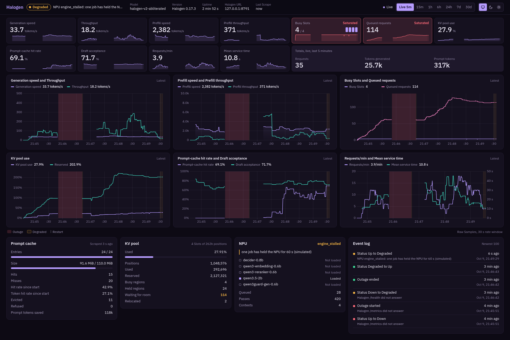
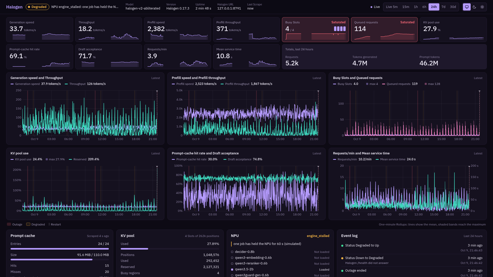
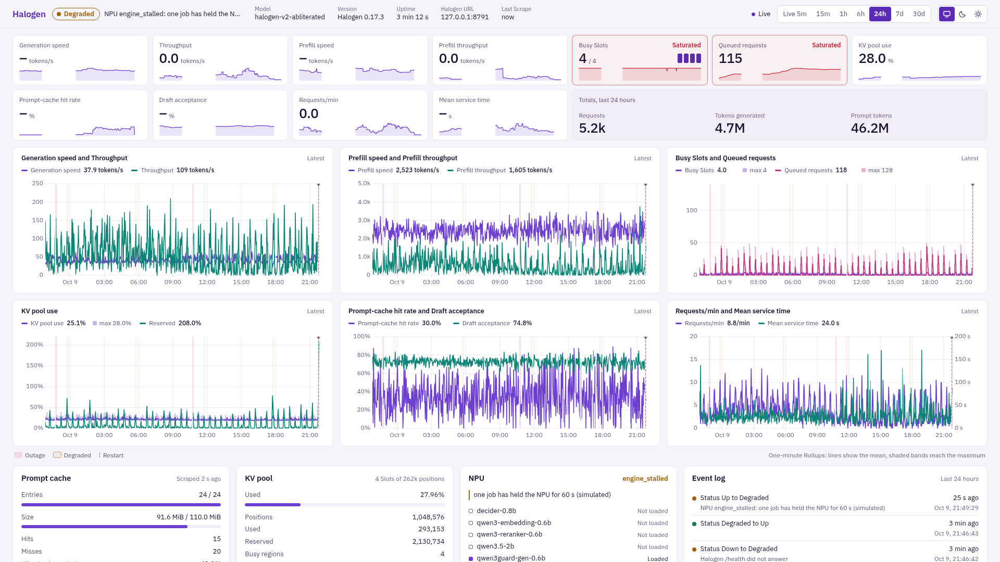
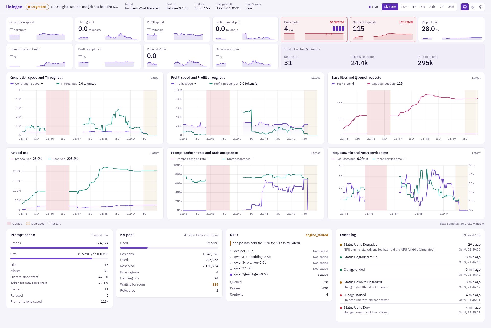
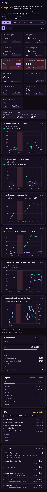

# Halogen Dashboard

A live dashboard for the Halogen LLM inference server. One Rust process (the Collector) reads Halogen each second, keeps the history in SQLite and sends live data to the web page.



| 24 h, dark | 24 h, light |
| --- | --- |
|  |  |

| Live, light | Phone |
| --- | --- |
|  |  |

The screenshots show simulated data from `fake-halogen`.

## What it shows

- Status (Up, Degraded or Down) with the reason, Uptime, model and version.
- Generation speed, Throughput, Prefill speed and Prefill throughput.
- Busy Slots, Queued requests and KV pool use, with Saturation colours.
- Prompt-cache hit rate, Draft acceptance, Requests/min and Mean service time.
- Prompt cache, KV pool and NPU details, and an event log.
- Time ranges: Live 5 min, 15 min, 1 h, 6 h, 24 h, 7 d and 30 d. The charts show Outages as gaps and Restarts as markers.
- Dark and light themes. The default theme follows the system setting.

`CONTEXT.md` defines each term.

## Important: one reader only

Halogen resets two throughput gauges each time a client reads `/metrics`. Thus the Collector must be the only client that reads Halogen `/metrics`. Do not add a Prometheus job for Halogen. Let Prometheus read `/metrics` on the Collector. Refer to `docs/adr/0001-collector-is-only-halogen-reader.md`.

## Run with Docker Compose

1. Copy the example file:

   ```sh
   cp .env.example .env
   ```

2. Set `HALOGEN_URL` in `.env`. Compose does not start if `HALOGEN_URL` is empty.
3. Start the dashboard:

   ```sh
   docker compose up -d --build
   ```

4. Open `http://127.0.0.1:8790`. To open the dashboard on the LAN, set `HALOGEN_DASHBOARD_BIND=0.0.0.0`.

The data is in the `halogen-dashboard-data` volume.

### Settings

| Variable | Default | Use |
| --- | --- | --- |
| `HALOGEN_URL` | none, required | Base URL of Halogen |
| `HALOGEN_DASHBOARD_BIND` | `127.0.0.1` | Host address for the port |
| `HALOGEN_DASHBOARD_PORT` | `8790` | Host port |
| `RUST_LOG` | `info` | Log level |
| `TZ` | `UTC` | Time zone of the container |
| `FAKE_HALOGEN_SEED` | `1` | Simulator random seed |
| `FAKE_HALOGEN_SPEED` | `1.0` | Simulator load multiplier |
| `FAKE_HALOGEN_CHAOS` | `false` | Simulator: add Outages, Restarts and Degraded periods |

### Try it with the simulator

Set these values in `.env`:

```sh
HALOGEN_URL=http://fake-halogen:8791
FAKE_HALOGEN_CHAOS=true
```

Then start both services:

```sh
docker compose --profile sim up -d --build
```

## Development

Requirements: Rust 1.98, Node 22 and pnpm 11.

```sh
(cd web && pnpm install && pnpm build)
cargo build --release
cargo test

# Simulated Halogen on 127.0.0.1:8791
target/release/fake-halogen --chaos

# Optional: 30 days of simulated history
target/release/halogen-dashboard seed --db data/dev.sqlite --days 30

# Collector on 127.0.0.1:8790
HALOGEN_URL=http://127.0.0.1:8791 HALOGEN_DASHBOARD_DB=data/dev.sqlite \
  target/release/halogen-dashboard --listen 127.0.0.1:8790
```

To change the web page, run `pnpm dev` in `web/` and open `http://127.0.0.1:5179`. Use `pnpm dev:mock` to work without the Collector.

You can trigger simulator events: `curl -X POST http://127.0.0.1:8791/_sim/{outage,restart,degrade,burst}`.

## Documents

- `CONTEXT.md`: terms
- `docs/collector-api.md`: Collector API, rate formulas and storage
- `docs/adr/`: decisions
- `fixtures/halogen-0.17.3/`: real Halogen 0.17.3 responses

## License

Licensed under either of [Apache License 2.0](LICENSE-APACHE) or [MIT license](LICENSE-MIT), at your option.
